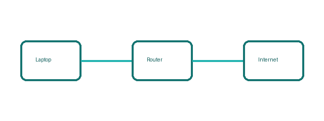

# Module 1: Hoe komt het dat niet iedereen aan mijn netwerk kan?

::: github
[Code Module 1](https://github.com/example/netwerken-module-1)
:::

---

## 1.1 Hoe data beweegt

Stel: je stuurt een bestand naar een vriend aan de andere kant van de wereld. Je klikt op "verzenden" en een seconde later heeft hij het. Wat is er net gebeurd? Het antwoord is minder magisch dan het lijkt en het begrijpen ervan legt de basis voor alles wat volgt.

Data beweegt over een netwerk niet als één groot blok, maar als kleine stukjes die afzonderlijk verstuurd worden. Die stukjes noemen we **packets**. Je bestand wordt opgesplitst, elk stukje krijgt een adres mee (een beetje zoals een envelop met een bestemming) en elk stukje kan een andere weg nemen om op de bestemming aan te komen. Aan de andere kant worden de stukjes terug samengevoegd tot het originele bestand. Dat hele systeem heet **packet switching** en dat maakt het internet robuust: bij congestie of uitval kan verkeer langs een andere route gestuurd worden.

Fysiek gezien beweegt die data via kabels (koper of glasvezel), draadloze signalen (WiFi, 4G/5G), of optische fiber. De technologie verschilt, maar het principe blijft hetzelfde: alle eentjes en nulletjes reizen van punt A naar punt B, via soms tientallen tussenliggende apparaten.

Als developer hoef je niet elk detail van die fysieke laag te kennen. Maar je moet weten dat **netwerkcommunicatie nooit gegarandeerd** is. Packets kunnen verloren gaan, vertraagd zijn of in de verkeerde volgorde aankomen. Protocollen zoals TCP vangen veel daarvan op met controles en hertransmissie, maar dat kost tijd. Je code moet daar rekening mee houden.

Dit betekent voor jou: bouw je applicatie alsof het netwerk soms traag, onvolledig of grillig reageert. Time-outs, retries en degelijke foutmeldingen zijn geen uitzonderingen maar de regel.

### Test jezelf 1.1 – Algorithm

```text
Sectie: 1.1
Type: meerkeuze (één antwoord is juist)
Vraag: Welke instructie is ondubbelzinnig?
Opties:
  A. Tel 21 % btw op bij de prijs.
  B. Voeg een beetje zout toe.
  C. Wacht tot het water warm genoeg is.
  D. Kies een kleur die goed past.
Juist: A
Feedback A: Juist. Iedereen die deze stap uitvoert, komt op hetzelfde bedrag uit (zie 1.1).
Feedback B: Hoeveel is een beetje? Twee mensen voegen een andere hoeveelheid toe (zie 1.1).
Feedback C: Wanneer is het warm genoeg? Maak het meetbaar, bijvoorbeeld 80 graden (zie 1.1).
Feedback D: Wat goed past, is een mening. Een computer heeft geen mening (zie 1.1).
```

```text
Sectie: 1.1
Type: koppelen
Vraag: Koppel elke eigenschap van een algorithm aan haar betekenis.
Paren:
  Ondubbelzinnig → Elke stap kan maar op één manier uitgevoerd worden
  Eindig → Het algorithm stopt na een eindig aantal stappen
  Vaste volgorde → Na elke stap is duidelijk welke stap volgt
  Algemeen → Het werkt voor elke geldige input
Feedback: Zie de tabel in 1.1.
```

```text
Sectie: 1.1
Type: numeriek
Vraag: Je voert het kaartjesalgoritme uit 1.1 uit met de stapel 6, 2, 8, 2, 4. Hoe vaak krijg je een nieuw kleinste kaartje? Het eerste kaartje in stap 1 telt niet mee.
Juist: 1
Feedback: Alleen bij het eerste kaartje 2 krijg je een nieuw kleinste kaartje. De tweede 2 is niet kleiner dan 2, dus het kleinste kaartje blijft hetzelfde (zie 1.1).
```

---

## 1.2 LAN vs WAN

Je zit momenteel op kot. Je laptop, je telefoon en de printer van je huisgenoot staan allemaal verbonden met dezelfde WiFi-router. Jullie kunnen bestanden delen, naar dezelfde printer sturen en elkaars scherm streamen zonder dat daarvoor het internet nodig is. Dat is een **LAN**, een **Local Area Network**.

{width=480}

Zodra je op een publiek toegankelijke website surft, verlaat je die bubbel en stap je het **WAN** in: het **Wide Area Network**. Het internet is het bekendste voorbeeld van een WAN, een reusachtig netwerk van netwerken dat de hele wereld bestrijkt. Je huisnetwerk is één klein eilandje dat via je internetprovider verbinding maakt met dat grotere geheel.

Het onderscheid is praktisch belangrijk. Binnen een LAN is communicatie snel, goedkoop en min of meer privé. Buiten je LAN, zodra data door het WAN reist, gelden andere regels: het is trager, minder betrouwbaar en je hebt geen controle meer over de infrastructuur. Als developer betekent dit dat een app die "gewoon werkt op mijn computer" heel anders kan reageren zodra ze over het publieke internet communiceert.

Een derde term die je soms tegenkomt is **MAN** (Metropolitan Area Network): een netwerk op stadsschaal, een voorbeeld hiervan is het EhB-netwerk, waarin alle campussen van Brussel verbonden zijn. In de praktijk zal je dit zelden tegenkomen als developer, maar de term bestaat.

Dit betekent voor jou: test niet alleen lokaal. Test ook expliciet een scenario waarin client en server op verschillende netwerken zitten, want daar komen de echte verrassingen boven.

---

## 1.3 Router, switch en modem

In een doorsnee Belgische woning staan al minstens twee van deze apparaten, dikwijls samengeperst in één kastje van je provider. Ze doen elk iets anders en de verwarring ertussen leidt tot zinloze supportgesprekken en slecht geconfigureerde thuisnetwerken.

De **modem** is het apparaat dat jouw netwerk verbindt met het netwerk van je internetprovider. "Modem" staat voor *modulator-demodulator*: het zet het digitale signaal van jouw apparaten om naar een signaal dat geschikt is voor de kabel of glasvezel van je provider en omgekeerd. Zonder modem ben je afgesneden van het internet. Meer doet een pure modem niet.

De **router** is het apparaat dat beslissingen neemt over waar data naartoe moet. Het kent alle apparaten in je LAN, weet welk publiek IP-adres jouw verbinding heeft en zorgt ervoor dat data van het internet bij het juiste apparaat terechtkomt en andersom. Routen betekent letterlijk "een route bepalen". De router spreekt twee talen tegelijk: die van je lokale netwerk en die van het internet.

De **switch** is een verdeler binnen je LAN. Als je meerdere apparaten via kabel wil verbinden, sluit je ze aan op een switch. Een switch stuurt data alleen naar het apparaat waarvoor het bedoeld is. Thuis heb je een switch zelden apart nodig; je router heeft er al een ingebouwd. In een bedrijfsnetwerk is een switch een apart apparaat dat tientallen of honderden apparaten bedient.

Tegenwoordig levert je provider je één kastje dat modem, router en switch in één combineert. Handig, maar het maakt het onderscheid wazig. Als developer is het verschil wel degelijk relevant: als je een server wil bereikbaar maken van buitenaf, moet je aan de **router** sleutelen, niet aan de switch of modem.

Dit betekent voor jou: bij storingen of configuratievragen benoem je eerst de rol die faalt (modem, router of switch) en pas daarna het toestel. Zo analyseer je scherper en los je sneller op.

---

## 1.4 Je thuisnetwerk

Theorie is mooi, maar een netwerk moet je aanraken. In deze sectie zet je een eenvoudig thuisnetwerk op en verifieer je of het werkt, met tools die je als developer sowieso nodig zult hebben.

Het startpunt is je router. De meeste routers zijn bereikbaar via een webbrowser op het adres `192.168.1.1` of `192.168.0.1`, dit is het **standaard gateway-adres**, de toegang tot je netwerk van binnenuit. Log in met de gegevens die op de onderkant van je router staan.

::: info
**Info:** bij sommige providers, zoals Telenet, beheer je je modem via hun website of app in plaats van via `192.168.0.1`.
:::

::: warning
**Let op:** verander het standaardwachtwoord van je router meteen na de eerste keer inloggen. De standaardwachtwoorden van de meeste routers zijn publiek gekend.
:::

Eenmaal ingelogd zie je het **dashboard** van je router: welke apparaten verbonden zijn, welke IP-adressen ze hebben, welk publiek IP-adres jouw verbinding heeft. Verken dit. Je ziet ook instellingen voor WiFi-netwerken (SSID en wachtwoord), DHCP (meer daarover in module 2) en firewall-regels.

### Testen met ping

Om te testen of je netwerk werkt, gebruik je de terminal. Het commando `ping` stuurt een klein pakketje naar een adres en wacht op antwoord. Je stopt `ping` met <kbd>Ctrl</kbd> + <kbd>C</kbd>.

#### Stap 1: je router

```bash
ping 192.168.1.1
```

```console
PING 192.168.1.1 (192.168.1.1): 56 data bytes
64 bytes from 192.168.1.1: icmp_seq=0 ttl=64 time=2.104 ms
64 bytes from 192.168.1.1: icmp_seq=1 ttl=64 time=1.873 ms
```

Als je router reageert, werkt je lokale verbinding.

#### Stap 2: het internet

```bash
ping 8.8.8.8
```

`8.8.8.8` is een [publieke DNS-server van Google](https://developers.google.com/speed/public-dns). Als die reageert, heb je verbinding met het internet. Reageert hij niet, maar je router wel? Dan is er een probleem tussen je router en je provider.

### Je eigen configuratie bekijken

Het commando om je eigen IP-adres, je subnetmasker en je standaard gateway te zien, verschilt per besturingssysteem:

1. Windows: `ipconfig`
2. Linux: `ip a`
3. macOS: `ifconfig`

Op Windows kan je in PowerShell ook een specifieke poort testen:

```powershell
Test-NetConnection 8.8.8.8 -Port 53
```

Dit betekent voor jou: als iets niet werkt, kijk je eerst naar je eigen configuratie voordat je de server of je code verdenkt.

### Test jezelf 1.4 – Je thuisnetwerk

```text
Sectie: 1.4
Type: meerkeuze
Vraag: Wat test dit commando?
Code:
  ping 8.8.8.8
Opties:
  A. Of je verbinding hebt met het internet
  B. Of je DNS werkt
  C. Welk IP-adres je eigen computer heeft
  D. Hoe snel je wifi is
Juist: A
Feedback A: Juist. `8.8.8.8` is een publiek IP-adres buiten je eigen netwerk (zie 1.4).
Feedback B: Een IP-adres heeft geen DNS nodig. Ping een domeinnaam om DNS te testen (zie 1.6).
Feedback C: Daarvoor gebruik je `ipconfig`, `ip a` of `ifconfig` (zie 1.4).
Feedback D: `ping` meet de tijd tot een antwoord, niet de snelheid van je wifi (zie 1.5).
Feedback bij juist antwoord: Goed gedaan.
Feedback bij fout antwoord: Herlees het stuk over ping in 1.4.

Sectie: 1.4
Type: koppelen
Vraag: Koppel elk besturingssysteem aan het commando dat je IP-adres toont.
Paren:
  Windows → `ipconfig`
  Linux → `ip a`
  macOS → `ifconfig`
Afleiders:
  `ping`
Feedback: Zie de lijst in 1.4.

Sectie: 1.4
Type: numeriek
Vraag: Een ping naar je router geeft `time=2.104 ms`. Rond af op één decimaal.
Juist: 2,1 ± 0,05 | 2,1
Feedback: 2,104 afgerond op één decimaal is 2,1 (zie 1.4).

Sectie: 1.4
Type: invullen
Vraag: Het standaard gateway-adres van de meeste routers is [[192.168.1.1|192.168.0.1]].
Feedback: Beide adressen komen veel voor (zie 1.4).
```

---

## 1.5 Met ofzonder kabel

WiFi is handig. Ethernet is beter. Dat klinkt bot, maar voor een developer heeft die keuze concrete gevolgen.

Een **bekabelde verbinding** biedt hogere en stabielere snelheid, lagere **latency** (vertraging) en geen interferentie van andere apparaten of muren. De kabel verbindt je direct met de switch in je router.

**WiFi** werkt draadloos via radiogolven. Het is flexibel en makkelijk, maar het heeft nadelen: het signaal verzwakt door muren en afstand, meerdere apparaten delen dezelfde frequentieband en de verbinding kan tijdelijk wegvallen. Voor streams, browsen en videogesprekken merk je dat nauwelijks. Voor het debuggen van een brakke netwerkomgeving of het draaien van een lokale server die snel moet reageren, is WiFi een bron van frustraties.

Twee veel gebruikte WiFi-standaarden zijn **2,4 GHz** en **5 GHz**. De 2,4 GHz-band draagt verder maar is trager en drukker (veel apparaten gebruiken die band). De 5 GHz-band is sneller maar heeft minder bereik. Moderne routers ondersteunen beide.

Als developer is de praktische regel eenvoudig: sluit je ontwikkelomgeving aan via kabel als je dat kunt. Test je applicatie daarna ook op WiFi, want je gebruikers doen dat wel.

Dit betekent voor jou: kies kabel om stabiel te ontwikkelen en te troubleshooten en gebruik WiFi bewust als realistische gebruikerstest.

---

## 1.6 Wat bij problemen?

Netwerken werken niet altijd. Dat is geen bug in het systeem, dat *is* het systeem. Als developer word je vroeg of laat geconfronteerd met een verbinding die het niet doet en dan is "*Hello, IT. Have you tried turning it off and on again?*" geen professioneel antwoord.

Troubleshooten doe je systematisch, van binnenuit naar buiten.

**Stap 1: Werkt je eigen machine?** Controleer of je een IP-adres hebt (`ipconfig` op Windows, `ip a` op Linux, `ifconfig` op macOS). Geen IP? Dan is er een probleem met je netwerkconfiguratie of DHCP.

**Stap 2: Werkt je lokale netwerk?** Ping je router (`ping 192.168.1.1`). Reageert die niet, dan is er een probleem tussen jouw machine en de router — kabelprobleem, WiFi-probleem, of routerprobleem.

**Stap 3: Werkt het internet?** Ping een publiek IP (`ping 8.8.8.8`). Als stap 2 lukt maar stap 3 niet, zit het probleem meestal tussen je router en je provider.

**Stap 4: Werkt DNS?** Ping een domeinnaam (`ping google.com`). Als `8.8.8.8` werkt maar `google.com` niet reageert, dan is je DNS kapot. Je hebt internet, maar je computer kan domeinnamen niet omzetten naar IP-adressen.

**Stap 5: Werkt de specifieke dienst?** Gebruik `traceroute` (Linux/macOS) of `tracert` (Windows) om te zien waar packets vastlopen op hun weg naar de bestemming.

```text
traceroute to example.com (93.184.215.14), 30 hops max
 1  192.168.1.1   1.9 ms
 2  10.24.0.1     8.4 ms
 3  * * *
```

Elke regel is een tussenstation. Sterretjes betekenen dat dat station niet antwoordt. Dat is niet altijd een fout: veel routers negeren traceroute bewust.

Nog niet zeker welke stap faalt? Begin opnieuw bij [je eigen configuratie](#1_4).

Dit stappenplan redt je van veel frustratie. De fout zit altijd ergens in die keten. Als je meteen begint te zoeken bij de server van je app, terwijl het probleem in je eigen DNS-instellingen zit, ben je uren kwijt.

Netwerkproblemen kunnen ook in je code zitten. Een verkeerde poort, een foute URL, een certificaat dat verlopen is, ... Dat zijn geen netwerkproblemen in de infrastructuurzin, maar ze voelen hetzelfde aan. Leer het onderscheid maken. Je bent degene die de diagnose moet stellen.

Dit betekent voor jou: werk altijd laag per laag en noteer je observaties. Dan maak je van "het werkt niet" een diagnose die je team echt vooruithelpt.

### Test jezelf 1.6 – Alle vraagtypes {#tj-alle-types}

```text
Sectie: 1.6
Type: meerdere antwoorden
Vraag: Welke commando's tonen je eigen IP-adres? Kies alle juiste antwoorden.
Opties:
  A. `ipconfig`
  B. `ip a`
  C. `ping 8.8.8.8`
  D. `ifconfig`
Juist: A, B, D
Feedback A: Juist, op Windows (zie 1.4).
Feedback B: Juist, op Linux (zie 1.4).
Feedback C: `ping` test een verbinding, het toont je eigen adres niet (zie 1.6).
Feedback D: Juist, op macOS (zie 1.4).

Sectie: 1.6
Type: juist/fout
Vraag: Als `ping 8.8.8.8` werkt maar `ping google.com` **niet**, dan is je DNS kapot.
Juist: juist
Feedback: Je hebt internet, maar de domeinnaam wordt niet omgezet naar een IP-adres (zie 1.6).

Sectie: 1.6
Type: ordenen
Vraag: Zet de stappen van het stappenplan in de juiste volgorde.
Volgorde:
  1. Werkt je eigen machine?
  2. Werkt je lokale netwerk?
  3. Werkt het internet?
  4. Werkt DNS?
Feedback: Je werkt van binnenuit naar buiten (zie 1.6).

Sectie: 1.3
Type: categoriseren
Vraag: Welk toestel doet wat?
Indeling:
  Zet het signaal om voor de kabel van je provider → Modem
  Bepaalt waar data naartoe moet → Router
  Verdeelt verkeer binnen je LAN → Switch
Afleiders:
  Versnelt je wifi
Feedback: Zie de rol van elk toestel in 1.3.

Sectie: 1.5
Type: dropdown
Vraag: De [[*5 GHz|2,4 GHz]]-band is sneller, maar heeft minder bereik.
Feedback: De 2,4 GHz-band draagt verder maar is trager (zie 1.5).

Sectie: 1.3
Type: woordenbank
Vraag: Een [[router]] verbindt netwerken, een [[switch]] verdeelt verkeer binnen je LAN.
Afleiders:
  modem
Feedback: Zie 1.3.

Sectie: 1.4
Type: invullen
Vraag: Welk commando stuurt een klein pakketje naar een adres en wacht op antwoord?
Juist: ping | ping.exe
Feedback: `ping` test of een adres bereikbaar is (zie 1.4).

Sectie: 1.4
Type: numeriek
Vraag: Hoeveel ms latency is aanvaardbaar naar je eigen router? Geef een waarde tussen 0 en 5.
Juist: 0 tot 5
Feedback: Op je eigen LAN is de latency meestal enkele milliseconden (zie 1.4).
```

---

## Veilig experimenteren {.letop #veilig-experimenteren}

Pas instellingen op je router alleen aan als je weet hoe je ze terugzet. Noteer vóór elke wijziging de oude waarde.

::: warning
**Let op:** zet de firewall van je router nooit uit om een probleem te testen. Je hele netwerk is dan bereikbaar vanaf het internet.
:::

Dit betekent voor jou: experimenteer op een testnetwerk of noteer elke wijziging, zodat je altijd terug kan.

::: oefening
[Oefeningen Module 1](./module-1-oefeningen.md)
:::
