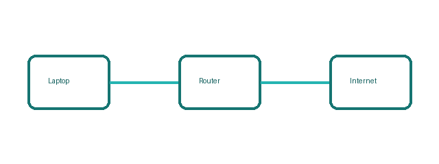

# Module 2: Placeholder

## 2.1 Voorbeeldsectie

Placeholder om een tweede (dichtgeklapte) module in het overzicht te tonen.

Een afbeelding zonder bijschrift en zonder vaste breedte:



Een codeblok zonder taal krijgt geen label en geen kleuren:

```
192.168.1.0/24
```

Meer achtergrond vind je op de pagina [Het OSI-model](./module-2-osi.md). Die pagina staat niet in het overzicht.
